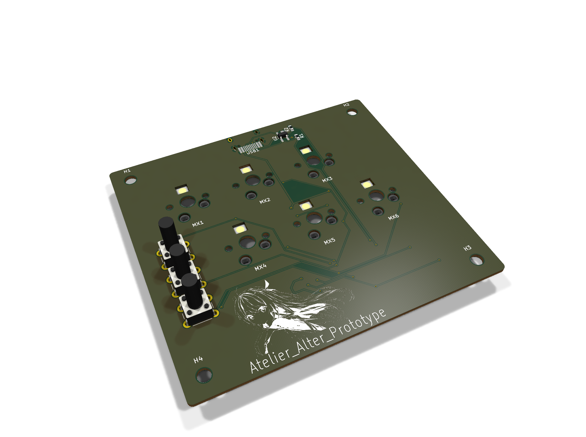
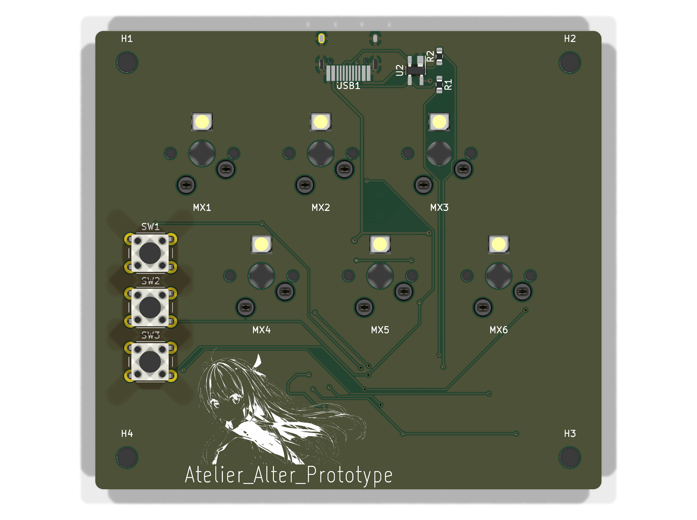
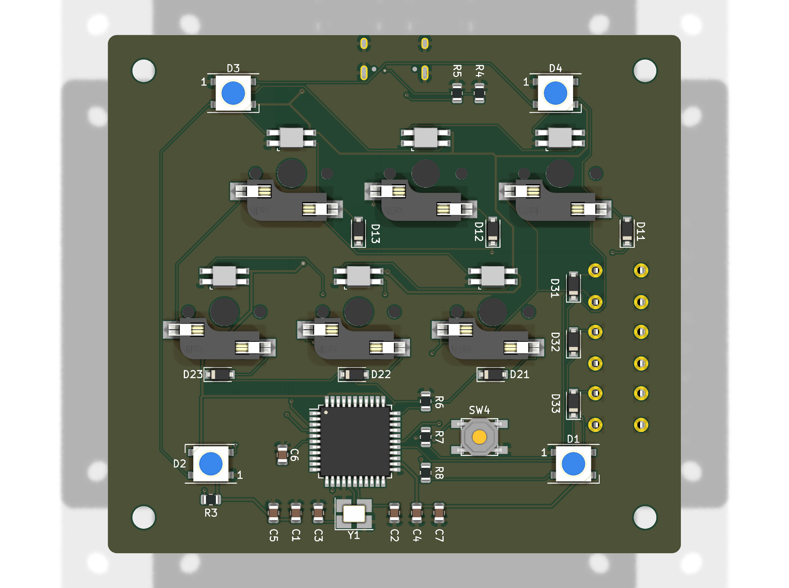
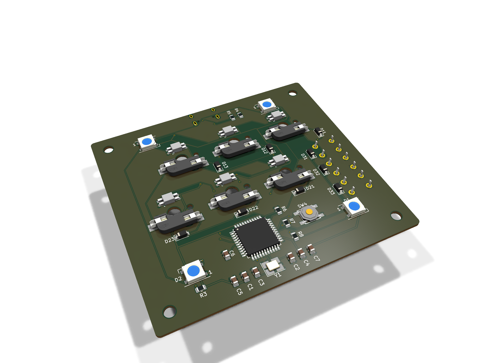
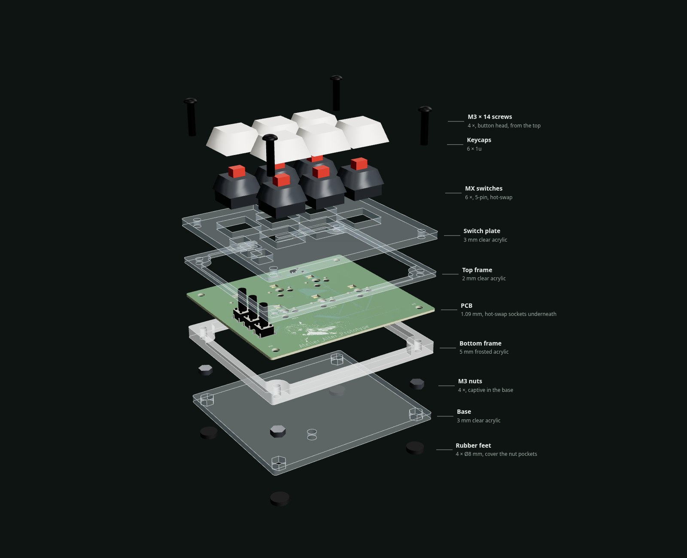
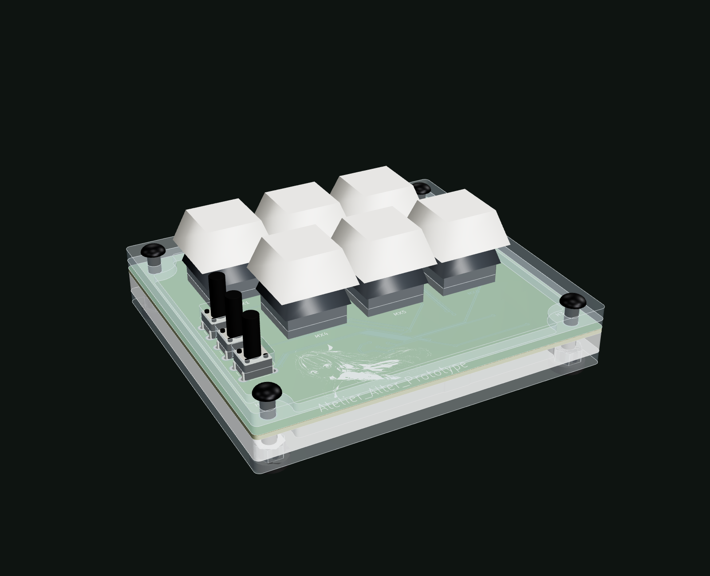
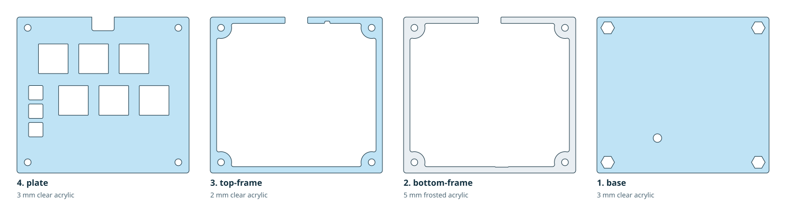
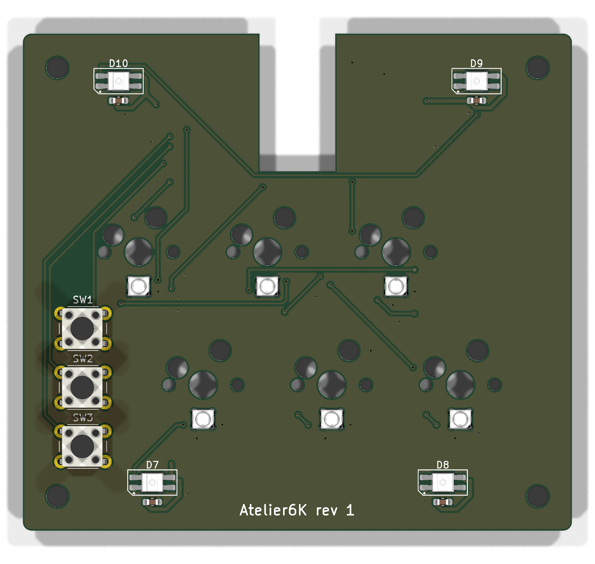

# Atelier6K

A 6-key mechanical keypad with 3 extra buttons, designed for osu! and usable as
a small macropad. ATmega32U4, USB-C, hot-swap sockets, per-key and underglow
RGB, QMK firmware with VIA.



**[Live demo](https://ateliermizumi.github.io/atelier-keypad/)** — rotate the
board in 3D and browse the schematic and PCB in the browser.

> [!WARNING]
> **Rev 0 is an unverified prototype.** It was designed in 2022 as a first PCB
> and has no recorded bring-up. A [design review](docs/design-review.md) found
> issues that should be fixed before anyone orders it, including a missing
> fuse and an LED chain the firmware cannot drive. Treat the files as a
> reference, not as a board ready to manufacture.

## Features

- 6 Cherry MX switches on Kailh hot-swap sockets, plus 3 tactile buttons, in a
  3 × 3 diode matrix
- Per-key reverse-mount RGB (6 LEDs) and underglow (4 LEDs)
- ATmega32U4 with a 16 MHz crystal, USB-C with ESD protection
- QMK firmware with VIA, 1000 Hz polling and runtime-adjustable debounce (rev 1 firmware)
- Stacked laser-cut acrylic case, 14 mm tall, generated from the PCB file
- 2-layer PCB, about 81 × 74 mm, hand-solderable parts (0805, SOD-123, TQFP-44)

## Renders

| Top | Bottom |
|-----|--------|
|  |  |



Schematic: [SVG](docs/images/schematic.svg)

### Case

Four laser-cut acrylic layers that follow the PCB outline and clamp the board
between them with four M3 screws. The cut files are generated from the KiCad
board, so cut-outs and screw holes always match the PCB.





| Layer | Acrylic | Job |
|-------|---------|-----|
| Switch plate | 3 mm clear | Locates the switches; top face 5.0 mm above the PCB |
| Top frame | 2 mm clear | Spacer that sets the switch height |
| Bottom frame | 5 mm frosted | Clears the sockets and spreads the underglow |
| Base | 3 mm clear | Captive M3 nuts, reset hole |



DXF files are in [`case/dxf/`](case/dxf). Materials, cutting notes and
assembly steps are in the [case design notes](docs/case.md). The case has not
been cut or test-fitted yet.

## Rev 1 (designed, not built)

`hardware/rev1/` holds the next revision: an RP2040-Zero module, 9 direct
pins, one chain of 10 SK6812MINI-E LEDs, a polyfuse and a level shifter, on
the same outline and screw holes. The schematic, board and routing are
generated from `hardware/rev1/circuit.py` by `scripts/rev1.sh` and pass
KiCad's ERC and DRC. It has not been fabricated; see
[docs/rev1-board.md](docs/rev1-board.md) for the open points before ordering.



## Repository layout

| Path | Contents |
|------|----------|
| `hardware/atelier6k/` | KiCad 10 project (schematic and PCB) |
| `hardware/libs/` | Footprint and symbol libraries (git submodules) and local footprints |
| `hardware/gerbers/rev0/` | Gerbers and drill files exported in 2022 |
| `hardware/bom.csv` | Bill of materials generated from the schematic |
| `firmware/atelier6k/` | Rev 1 QMK keyboard (RP2040), runtime debounce and its tests |
| `firmware/via/` | VIA v3 definition with the debounce menu |
| `firmware/build/` | Built firmware (`atelier6k_default.uf2`) |
| `firmware/legacy-2022/` | Rev 0 firmware and its 2022 build |
| `case/` | Case generator (`generate.py`), its tests, DXF cut files; 2022 drawings in `legacy/` |
| `docs/` | Design review, case notes, ERC/DRC reports, schematic, images |
| `site/` | The demo page published to GitHub Pages |
| `scripts/` | `export.sh` regenerates all derived files; `check-assets.sh` checks image links |

Clone with submodules:

```sh
git clone --recurse-submodules https://github.com/AtelierMizumi/atelier-keypad.git
```

The original KiCad 6 files are kept under the tag `rev0-kicad6`.

## Regenerating renders and reports

`scripts/export.sh` runs `kicad-cli` (KiCad 10 or newer) from your system, or
from the official KiCad Docker image when KiCad is not installed:

```sh
./scripts/export.sh          # renders, GLB, schematic SVG, BOM, ERC/DRC, case DXF
./scripts/check-assets.sh    # fails if any image reference leaves the repo
```

## Firmware

`firmware/atelier6k/` is the rev 1 firmware for current QMK (0.34.8): RP2040,
nine direct-pin keys, one chain of ten RGB LEDs, VIA.

- **1000 Hz** USB polling.
- **Debounce adjustable at runtime**, 0–25 ms, from a slider in VIA. A press
  is reported on the scan that first sees it; the debounce time only delays
  the release. The setting is stored on the keypad.
- **Three mode layers**, osu! standard, taiko and mania, switched with a side
  button and shown by the underglow colour. Every key is remappable in VIA.
- Brightness capped at 120 of 255 to stay inside the USB current budget.

It has been compiled and its debounce logic is unit-tested, but it has **not
run on hardware**: rev 1 of the board does not exist yet, and the pin
assignment in `keyboard.json` is provisional until the PCB is routed.

```sh
./scripts/firmware.sh        # unit tests, lint, build firmware/build/atelier6k_default.uf2
```

The script needs Docker and a QMK checkout; see the comment at its top.
To use the VIA menu, load `firmware/via/atelier6k.json` in VIA's Design tab.

The 2022 firmware for the rev 0 ATmega32U4 board is kept in
`firmware/legacy-2022/`; it does not build on current QMK.

## License

- Hardware (`hardware/`, `case/`): [CERN-OHL-P v2](LICENSES/CERN-OHL-P-2.0.txt)
- Firmware (`firmware/`): [GPL-2.0-or-later](LICENSES/GPL-2.0-or-later.txt), as required by QMK
- Third-party libraries under `hardware/libs/` keep their own licenses
