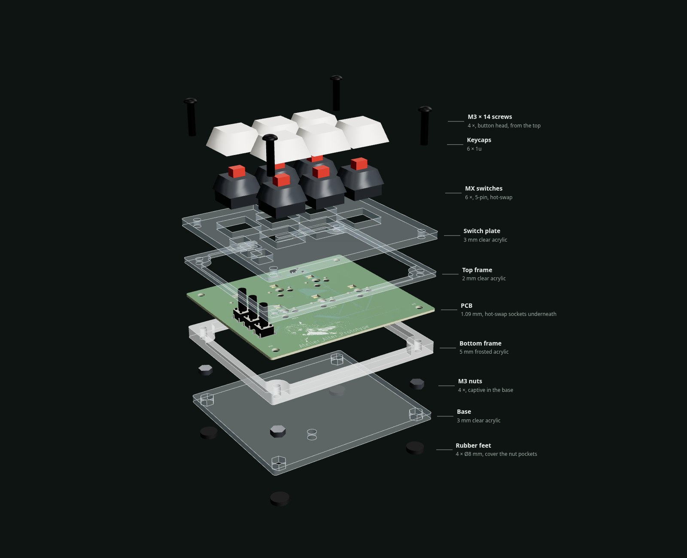
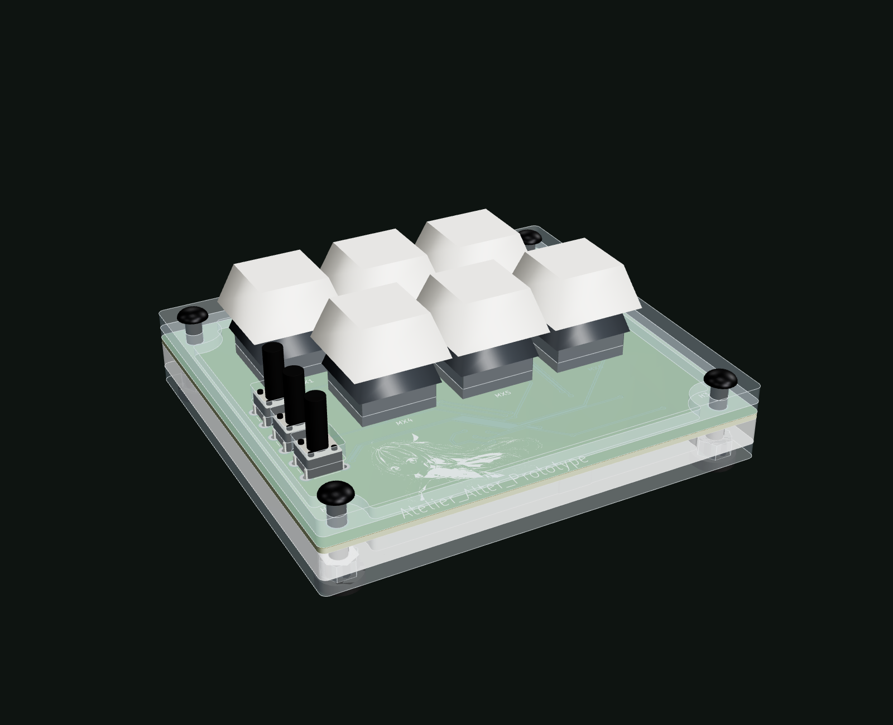
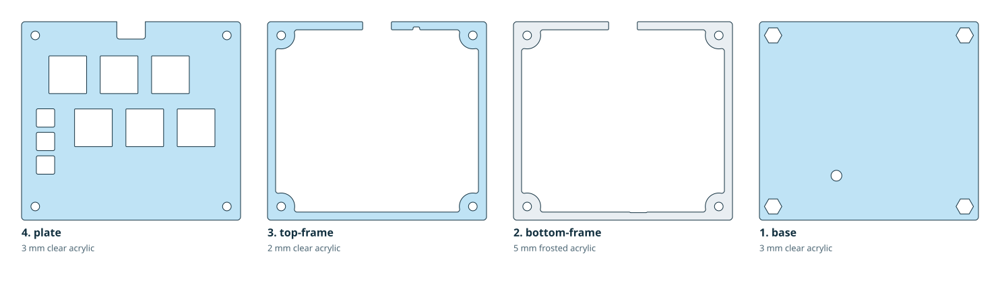

# Atelier6K acrylic case

A stacked, laser-cut acrylic case, redesigned in November 2026. It replaces the
2022 drawings, which are kept in [`case/legacy/`](../case/legacy).

**Status: not built.** The geometry is generated from the PCB file and checked
by automated tests, but no one has cut or assembled it yet. Cut one set and
test-fit it before ordering more.





## The stack

| # | Layer | Acrylic | Height above PCB top | Job |
|---|-------|---------|----------------------|-----|
| 4 | Switch plate | 3 mm clear | +2.0 … +5.0 mm | Locates the switches; its top face is the Cherry MX seating height |
| 3 | Top frame | 2 mm clear | 0 … +2.0 mm | Spacer between PCB and plate |
| — | PCB | — | −t … 0 | Clamped between the frames |
| 2 | Bottom frame | 5 mm frosted | below the PCB | Clears sockets and solder joints; spreads the underglow |
| 1 | Base | 3 mm clear | below the frame | Holds the nuts; hole for the reset button |

Total height is 13 mm of acrylic plus the PCB thickness: 14.1 mm with the
1.0 mm board defined in the KiCad file, 14.6 mm with a standard 1.6 mm board.



## Design decisions

**The PCB is a layer of the stack.** Every layer has the same outline as the
PCB (81.28 × 73.66 mm), and the four M3 screws pass through the PCB's own
mounting holes. Acrylic sheet varies by about ±10 % in thickness; with a single
clamped column, that variation changes the total height slightly and nothing
else. A case that surrounds the PCB needs two stacks to add up to the same
height, and would rattle or bow when they do not.

**Plate height comes from two sheets.** A Cherry MX switch sits with its
shoulder 5.0 mm above the PCB. The 2 mm frame plus the 3 mm plate give exactly
that. A 3 mm plate is too thick for the switch clips to latch (they need
1.5 mm), which is fine here: the 5-pin switches are located by the PCB and
held by the hot-swap sockets, and the plate stops them rocking.

**Captive nuts, flat bottom.** The base has hexagonal pockets (5.6 mm across
flats) at the four corners. An M3 nut drops in, cannot turn, and is pulled up
against the bottom frame when the screw is tightened. Nothing protrudes from
the bottom, and the rubber feet go over the pockets so the nuts cannot fall
out when the case is open.

**Frames are derived from the components.** Each frame is a 3 mm wall around
the outline with a round lug at every screw. The generator then removes
anything within 0.5 mm of a component courtyard on that side of the board, so
a part moved in KiCad moves the relief with it. On the current board this
produces one small notch in the top frame beside R2.

**One opening: the USB bay.** The receptacle's shield legs pass through the
PCB 0.4 mm from the board edge, so neither frame can carry a wall past it. Both
frames stop either side of the connector (10.6 mm gap), and the plate is
notched above it because the receptacle (3.26 mm tall) is higher than the
plate's underside. The receptacle mouth sits 1.4 mm outside the case edge, so
a plug's overmould clears the case.

**Tact switches come through the plate.** Their bodies are 3.5 mm tall and
would touch the plate underside, so each gets a 6.8 mm square cut-out. The
13 mm plungers stand 8 mm above the plate.

## Bill of materials

| Qty | Part | Notes |
|----:|------|-------|
| 1 | 3 mm clear acrylic, 2 parts | Plate and base |
| 1 | 2 mm clear acrylic, 1 part | Top frame |
| 1 | 5 mm frosted (opal) acrylic, 1 part | Bottom frame. Clear works too, with less diffusion |
| 4 | M3 × 14 button-head screw (ISO 7380) | See the note on length below |
| 4 | M3 hex nut (DIN 934, 5.5 mm AF, 2.4 mm thick) | |
| 4 | Self-adhesive rubber foot, Ø8 mm × 2 mm or larger | |

**Screw length.** The screw enters from the top and must end inside the base.
With M3 × 14 the nut is fully engaged for both board thicknesses; the tip ends
0.1 mm (1.0 mm PCB) or 0.6 mm (1.6 mm PCB) short of the bottom face. If only
M3 × 16 is available it protrudes by up to 1.9 mm, which 2 mm feet still
cover. M3 × 12 is too short.

## Cutting

Files are in [`case/dxf/`](../case/dxf), in millimetres, top view:

| File | Sheet |
|------|-------|
| `atelier6k-case-plate-3mm.dxf` | 3 mm clear |
| `atelier6k-case-base-3mm.dxf` | 3 mm clear |
| `atelier6k-case-top-frame-2mm.dxf` | 2 mm clear |
| `atelier6k-case-bottom-frame-5mm.dxf` | 5 mm frosted |
| `atelier6k-case-all.dxf` | Overview of all four parts, one DXF layer per thickness |

DXF layers: `CUT-OUTLINE` (red) is the outer profile, `CUT-INNER` (blue) holds
holes and cut-outs and should be cut first, `NOTES` (grey) is text and must
not be cut.

- The drawings are nominal size with **no kerf compensation**. Ask the shop to
  compensate, or expect holes about 0.1–0.2 mm larger than drawn. That is
  acceptable everywhere on this design; the switch cut-outs only need to be at
  least 14.0 mm.
- The top frame is a 3 mm wall in 2 mm sheet and is fragile until it is
  clamped in the stack. Leave the protective film on until assembly.
- Switch cut-outs have 0.3 mm corner radii and the frames 1 mm inside fillets,
  to avoid the sharp inside corners where acrylic cracks.

## Assembly

1. Peel the film from all four parts.
2. Press the four nuts into the base pockets and stick a rubber foot over each.
3. Lay the bottom frame on the base, then the assembled PCB (components
   soldered, switches not yet fitted), then the top frame and the plate. The
   USB notch and bays all face the same edge.
4. Fit the four screws from the top and tighten them until snug. Acrylic
   cracks if the screws are forced.
5. Push the switches through the plate into the hot-swap sockets, supporting
   the base under each socket, then fit the keycaps.

The reset button is reached through the 4 mm hole in the base.

## Changing the design

Everything comes from `case/generate.py`, which reads the outline, screw
holes, switch and button positions, USB connector and component keep-outs
from `hardware/atelier6k/atelier6k.kicad_pcb`. Thicknesses, wall width,
clearances and cut-out sizes are fields of `Params` at the top of that file.

```sh
uv run case/generate.py                                   # DXF, drawing, viewer data
cd case && uv run --no-project --with pytest --with shapely --with ezdxf pytest -q tests
```

The tests check the design against the board: no frame touches a component,
each cut-out lines up with its part, the plate top is at 5.0 mm, the layers
are flush with the PCB, and the screw engages the nut without protruding.

The two renders above are screenshots of the interactive viewer
(`site/case.html`) at 1600 × 1300:

- exploded: `case.html?explode=1&ui=0&tx=18`
- assembled: `case.html?explode=0&ui=0&labels=0&el=30&az=-28`

In the viewer the acrylic and PCB are exact; switches, keycaps, screws, nuts
and feet are simplified stand-ins.

## Open points

- Not test-fitted. The HRO receptacle and tact-switch dimensions are from
  datasheets, not measured parts.
- PCB thickness: the KiCad stack-up says 1.0 mm. Hot-swap sockets and 5-pin
  switches are designed around 1.6 mm boards; decide before ordering PCBs. The
  case works with either.
- The per-key LEDs shine up through the switches; the plate is clear, so the
  light also spreads across it. A black or frosted plate would change that
  look and is a one-word change in `generate.py` (`material`), with no effect
  on the cut files.
