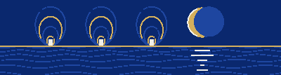

# PCB art and easter eggs

## Four tones instead of one

Rev 0's drawing is a black-and-white trace of a character, printed in
silkscreen only: one tone (white) on one background. A PCB can show four:

| Tone | What the fab makes | Looks like (dark mask, ENIG) |
|---|---|---|
| 0 | Solder mask over bare laminate | the darkest |
| 1 | Solder mask over copper | a lighter sheen of the mask colour |
| 2 | Copper with the mask opened | gold (silver with HASL) |
| 3 | Silkscreen | white |

`tools/pcb_art/art.py` posterises a grayscale image into these four tones and
writes a KiCad footprint (8 tests):

```sh
cd tools/pcb_art
uv run --no-project --with pillow python art.py IN.png OUT.kicad_mod \
    --width 60 --side B --preview preview.png --mask blue --finish enig
```

It keeps every feature at least two pixels (0.3 mm) wide so the fab can print
it, merges pixels into rectangles so the file stays small, and mirrors
bottom-side art so it reads correctly through the clear base. Art copper has
no net: give its area a zone keep-out so the ground pour does not swallow it.
ENIG costs extra at JLCPCB; with HASL the bare-copper tone is silver.

## One look per revision

Each revision gets its own mark, so a photo tells them apart at a glance:

| | Rev 0 (2022) | Rev 1 (2026) | Rev 2 (HE) |
|---|---|---|---|
| Theme | The person who started it | A board written as code | Magnets and the night sea |
| Art | Your ATRI trace, unchanged | Proposed: the router's own grid: the A* search pattern of one net, printed in tone 1 under the switches | Moon over the sea, with the three magnets' field lines (below) |
| Where | Top, beside the buttons | Top, between the keys | Top, in the palm area under the clear cover, lit by the underglow |
| Tones | 1 (silkscreen) | 2 (copper under mask + silkscreen) | 4 |
| Mask | Green | Black | Blue |



The rev 2 art is drawn in code (`tools/pcb_art/motif_rev2.py`), so it belongs
to the project and can be published with it: the moon is bare gold copper
with a crescent of copper under the mask, the three white bars on the
horizon are the magnets, and their dipole field lines alternate gold and
blue. The moonlight on the water is silkscreen.

## About character art

The ATRI picture on rev 0 is a trace of official game art, which belongs to
its publisher. On a board you built for yourself that is your call. In a
public repository licensed CERN-OHL, it is redistribution of someone else's
artwork, and I could not find a fan-content policy for ATRI that allows it.
So:

- **Rev 0 keeps its art as it was.** It is history; it stays.
- **For new boards, character art stays private.** Put your own edited image
  in `hardware/he/art/private/` (ignored by git) and run `art.py` on it
  locally. The footprint goes on your unit; the repository keeps only the tool
  and the original art above.
- **If you want a character in the public files**, the clean ways are art
  you draw yourself, a commission whose licence allows open hardware, or
  a work under CC0/CC BY.

For good results from a photo-like source: crop tight, raise contrast until
the face reads in four flat levels, and check the preview at 100 %; anything
thinner than 0.3 mm disappears.

## Easter eggs on rev 2

| Where | What | How you find it |
|---|---|---|
| Under the middle keycap's rim | `00:00` in small slanted digits: the hour that should not exist | Pull the keycap |
| Palm area, under the cover | The moon-and-field-lines art, gold under the cyan underglow | Rest your hand on it |
| Inside the wall layer (to engrave) | The model's field curve, laser-engraved: "6.1 mm → 2.1 mm, 9 → 82 mT" | Open the case |
| Bottom, at the wrist edge | `26.05.2022`, rev 0's first commit | Open the case |
| Firmware | Hold Esc and retry for 3 s: the underglow sweeps like a tide | Try it |
| Firmware | Tap faster than 15 presses per second for 2 s and the underglow turns from blue to white until you stop | Stream |

All of these are original; none uses a game's names, logos or artwork.
