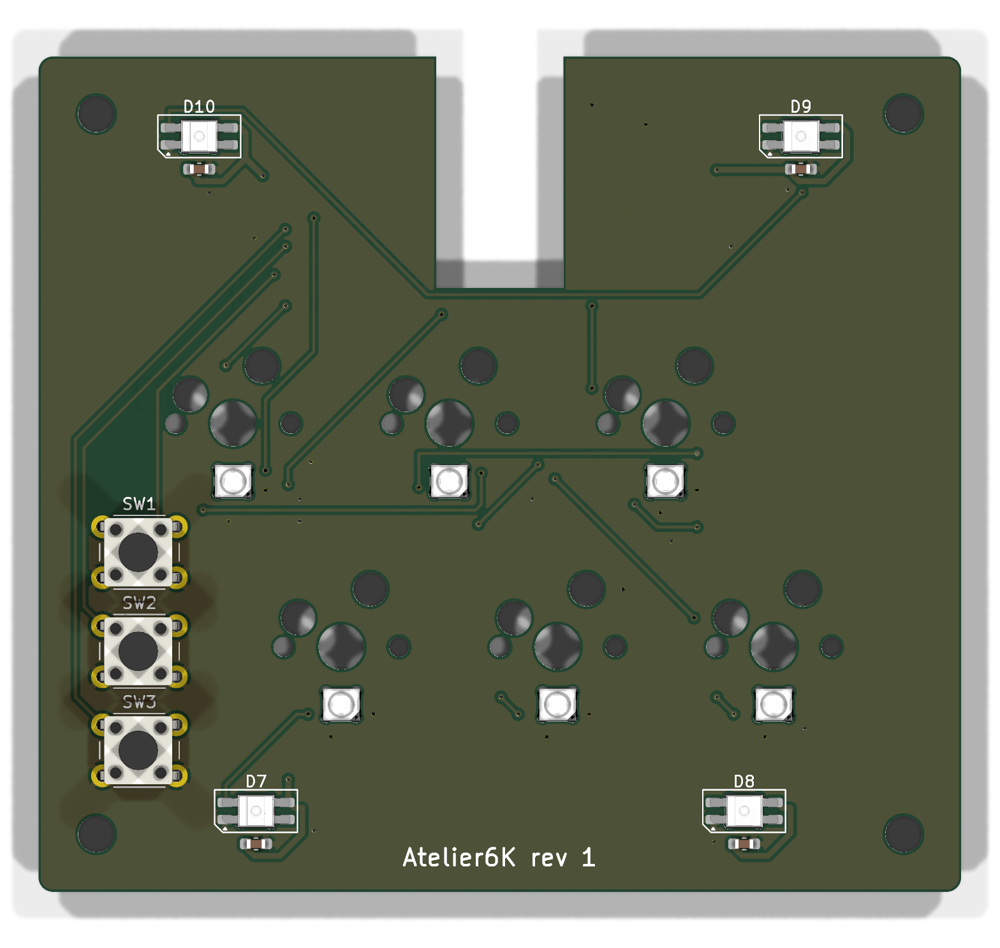
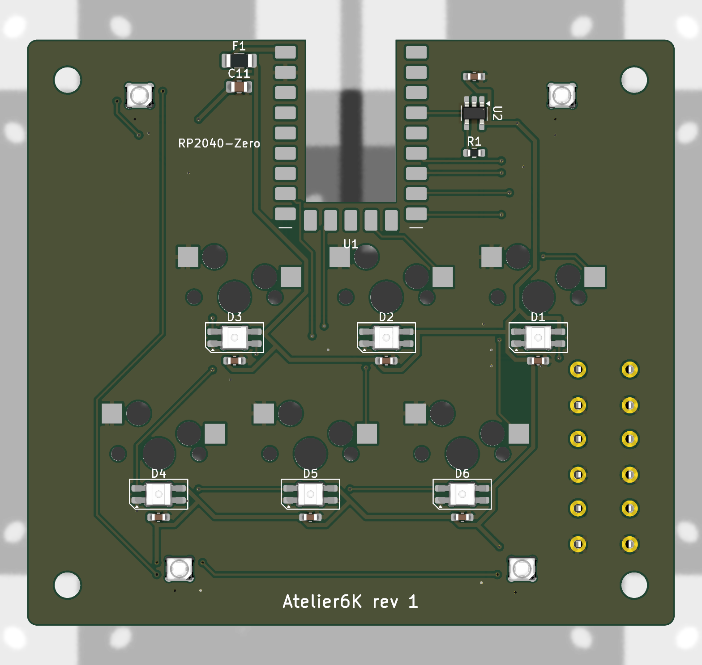
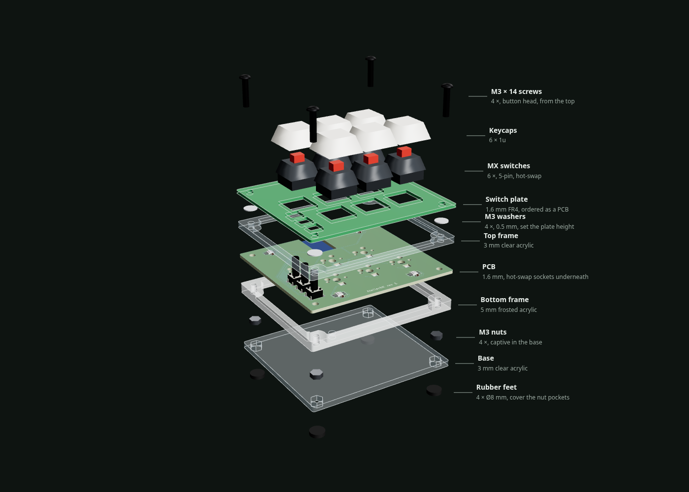
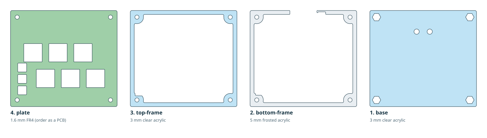

# Atelier6K rev 1 — schematic and board

Status on 2026-11-14: **designed and rule-checked, never built.** The files
pass KiCad's ERC and DRC; nothing here has been fabricated, soldered or
powered. Read "Before ordering" below first.




Schematic: [rev1-schematic.svg](images/rev1-schematic.svg). Decisions and
part choices: [rev1-research.md](rev1-research.md).

## How it is made

The circuit and the placement are data in `hardware/rev1/circuit.py`. The
schematic, the board and the routing are generated from it:

```sh
scripts/rev1.sh          # tests, library, schematic, placement, routing, ERC, netlist check, DRC
scripts/rev1.sh check    # checks only
```

| File | Role |
|------|------|
| `circuit.py` | Parts, nets, positions, pin map. Edit this, then run the script |
| `tests/test_circuit.py` | 15 checks of the circuit against the agreed design and the firmware pin map |
| `gen_lib.py` | Symbol and footprint for the RP2040-Zero (`hardware/libs/local/`) |
| `gen_sch.py` | Writes the schematic: every pin gets a wire stub and a net label |
| `gen_pcb.py` | Outline, footprints, nets, ground pours |
| `route.py` | Grid router written for this board (0.25 mm grid, two layers, vias) |
| `check_netlist.py` | Compares KiCad's netlist export with `circuit.py` |

The schematic is a labelled parts list, not a hand-drawn diagram. It is
electrically complete and KiCad opens it, but it is laid out for checking,
not for reading at a glance.

## Checks that pass

| Check | Result |
|-------|--------|
| Circuit tests | 15 of 15 |
| ERC | 0 violations |
| Netlist export equals `circuit.py` | 24 nets, 102 pins |
| DRC | 0 errors, 7 silkscreen warnings |
| Unconnected items | 0 |
| Schematic parity | 0 issues |

Reports: `docs/reports/rev1-erc.json`, `docs/reports/rev1-drc.json`.
Design rules used: 0.2 mm clearance, 0.25 mm signal tracks, 0.5 mm for VBUS,
+5V and GND, 0.6/0.3 mm vias, 0.2 mm copper to board edge, 1.6 mm board.

## What changed from rev 0

| Area | Rev 1 |
|------|-------|
| MCU | RP2040-Zero module under the board, USB-C on the top edge where the old connector was |
| Board edge | Same outline and screw holes, plus an 11.2 x 20.4 mm notch under the module |
| Keys | Same 3 + 3 stagger, moved 12.7 mm towards the user to make room for the module; switches turned so the LED faces south |
| Buttons | Same column, moved 8.0 mm down |
| Wiring | 9 direct pins, no diodes |
| LEDs | 10 x SK6812MINI-E in one chain: D1-D6 under the keys, D7-D10 underglow, 100 nF each |
| Protection | 500 mA polyfuse between the module's 5 V pin and everything on this board |
| LED data | 74AHCT1G125 level shifter and a 330 ohm series resistor |

Pin map (also in `firmware/atelier6k/keyboard.json`, and a test keeps the two
in step):

| Signal | GPIO | Signal | GPIO |
|--------|------|--------|------|
| K1 | GP8 | K4 | GP9 |
| K2 | GP10 | K5 | GP12 |
| K3 | GP14 | K6 | GP15 |
| B1 | GP7 | B2 | GP6 |
| B3 | GP5 | LED data | GP3 |

## Why the keys moved

The plan was to keep every rev 0 position. The RP2040-Zero is 23.5 mm long
and rev 0 leaves 12.6 mm between the top edge and the top row, so the module
cannot sit at the top with the keys where they were. The alternatives were a
side-exit USB cable or a taller board. Moving the key block down keeps the
outline, the screw holes and the cable at the top; the cost is that the empty
strip is now above the keys instead of below.

## Why there is a notch

The RP2040-Zero has parts on both faces (the RP2040 itself is on the back).
To solder it flat by its castellated edges, the board is cut away under the
module's back. The module's front, with the USB-C socket and the BOOT and
RESET buttons, faces down into the case.

## Case for rev 1

`uv run case/generate.py --rev1` (also run by `scripts/rev1.sh`) builds the
case from the rev 1 board; 15 tests in `case/tests/test_case_rev1.py` check it.




| Layer | Material | Notes |
|-------|----------|-------|
| Plate | 1.6 mm FR4, ordered as a PCB | MX switches clip in. The agreed 1.5 mm is not a stock PCB thickness; 1.6 mm is within the switch's tolerance |
| Washers | 4 x M3, 0.5 mm | Between top frame and plate, so the plate top is 5.1 mm above the PCB (MX: 5.0) |
| Top frame | 3 mm clear acrylic | Closed ring; nothing passes through at the USB end any more |
| Bottom frame | 5 mm frosted acrylic | Open at the top edge for the module; the module with its USB-C socket is about 4.3 mm tall |
| Base | 3 mm clear acrylic | Nut pockets, plus two 4 mm holes to reach BOOT and RESET with a toothpick |

Screws are M3 x 14 from the top, as before. The washers leave a 0.5 mm slit
between top frame and plate. Interactive view: `site/case.html?rev=1`.

## Before ordering

These are not covered by ERC or DRC.

1. **Notch size.** 11.2 mm wide is taken from the pad geometry, not from a
   measurement of the parts on the module's back. Measure a real module, or
   check Waveshare's STEP file.
2. **LED pinout.** Pin numbers come from KiCad's `SK6812MINI-E` symbol and
   footprint (1 VSS, 2 DIN, 3 VDD, 4 DOUT). A search on 2026-11-14 found
   datasheet copies that number the pins differently (for example 1 VDD,
   2 DOUT, 3 GND, 4 DIN), and a note that datasheet revisions disagree. What
   matters is which corner each signal is on: compare the footprint with the
   top-view drawing in the datasheet of the exact part bought, remembering
   that the key LEDs are mounted from the bottom.
3. **Module pinout and dimensions** were read from Waveshare's two drawings.
   Clones can differ.
4. **5 V path.** The polyfuse protects this board's LEDs and logic. It does
   not protect the module, whose 5 V pin is wired to USB VBUS on the module.
   USB data lines never leave the module, so this board adds no ESD parts.
5. **Routing quality.** The router is simple: 64 vias and some long detours.
   It is acceptable for these slow signals, and worth a look in KiCad.
6. **BOOT button access.** It faces the base plate. Firmware has Bootmagic
   (hold K1 while plugging in); the case needs a hole for the worst case.
7. **BOOT and RESET holes in the base** are placed from Waveshare's drawing
   (5.0 mm either side of the centre line, 16.2 mm from the USB end), not
   from a measured module.
8. **Done: the FR4 plate has Gerbers.** They are `plate-gerbers/` in the rev 1
   package, made from the same outline as
   `case/dxf-rev1/atelier6k-case-plate-1.6mm.dxf`.
9. **Fab house rules.** Run the manufacturer's own DFM check.

## How to order

1. Build the package with `scripts/fab.sh rev1` (after `scripts/rev1.sh`), or
   download the `rev1-package` artifact from the latest CI run. It holds the
   same files.
2. **Board:** upload `gerbers/` to JLCPCB as 2 layers, FR-4, 1.6 mm. Choose SMT
   assembly on both sides, and upload `bom-jlcpcb.csv` and `cpl-jlcpcb.csv`.
   Check every bottom part in the placement preview.
3. **Plate:** order `plate-gerbers/` as a separate 1.6 mm FR-4 board, without
   assembly.
4. **Hand parts:** buy what `hand-parts.csv` lists: the RP2040-Zero, six Kailh
   MX hot-swap sockets and three 6 × 6 mm tact switches.
5. **Case:** laser-cut the three acrylic layers in `case-dxf/`.
6. Before paying, go through items 1–3 above. `README.txt` in the package
   repeats them as a checklist.
