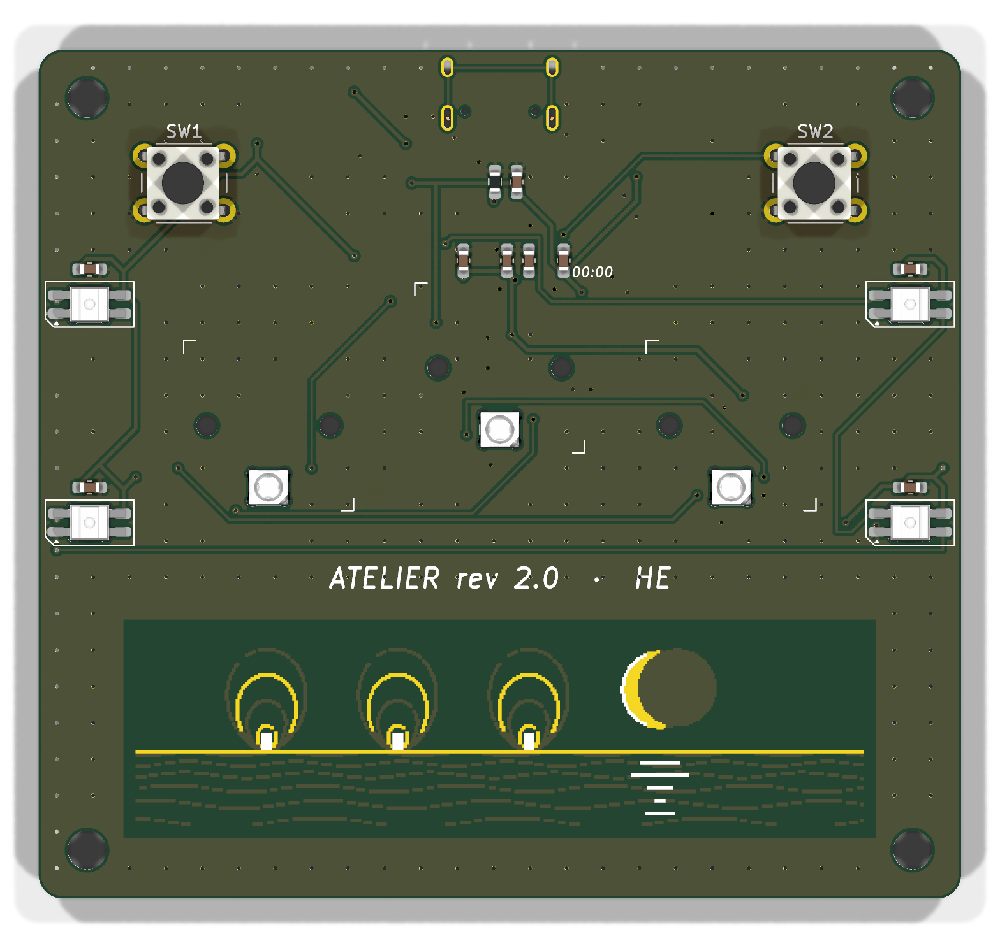

# Rev 2.0 (Hall effect): the board

Designed, routed, checked, with order files, firmware and CI; **not built**.
The rev 2.0 work follows the [production plan](superpowers/plans/2026-11-14-atelier-rev2-production.md)
(issues #1–#11). Assembly and acceptance: [`rev2-bringup.md`](rev2-bringup.md).
Ordering: [`build/ordering.md`](build/ordering.md).

```sh
scripts/he.sh          # circuit tests, schematic, place + route, ERC, netlist, DRC,
                       # layout tests, renders, case, 3D model
scripts/he.sh check    # checks only, on the files as they are
scripts/fab.sh         # production package in build/fab/rev2.0 (after he.sh)
firmware/he/build.sh   # libhmk firmware in build/fw
```

## Results

| Check | Result |
|---|---|
| Circuit, layout and package tests (`hardware/he/tests/`) | 40 pass (with the package built) |
| ERC | 0 |
| Netlist against `circuit.py` | 34 nets, 178 pins, identical |
| DRC | 0 errors, 0 unconnected, schematic parity 0; 8 silkscreen warnings |
| Routing | 635 track segments, 328 vias (most of them stitch the two ground pours) |
| USB pair, connector to MCU | under 15 mm each, matched within 3 mm |
| Case tests (`case/tests/test_case_he.py`) | 15 pass (51 with rev 0 and rev 1) |
| Firmware config (`firmware/he/tests/`) | 6 pass; build 30.7 kB |



## What the files are

| File | Job |
|---|---|
| `hardware/he/circuit.py` | Every part, net and position; the AT32F405 LQFP48 pin table from the datasheet |
| `hardware/he/gen_lib.py` | AT32F405 symbol (from that table) and the PCB-mount magnetic switch footprint |
| `hardware/he/gen_sch.py` | The schematic (adapted from rev 1) |
| `hardware/he/gen_pcb.py` | Outline, footprints, ground pours, the art keep-out, silkscreen easter eggs |
| `hardware/he/route.py` | Rev 1's maze router tuned for 0.5 mm pitch, plus ground stitching |
| `case/generate_he.py` | The sealed case: DXF in `case/dxf-he/`, model in `site/assets/case-he.json` |
| `tools/pcb_art/` | The four-tone art footprint and its original artwork |

## Decisions made while laying it out

Each of these came from a failed check, not from the plan:

- **One LDO, a ferrite to the analog rail.** The datasheet requires VDDA at the
  same potential as VDD, so the sensors and VDDA hang off the 3.3 V rail
  through a 600 Ω ferrite instead of a second regulator.
- **The USB-C receptacle sits 2.5 mm in from the edge.** Its front shield legs
  were outside the board at the edge.
- **The MCU sits on the 0.25 mm routing grid.** Half a grid step off, its side
  pins became unreachable for the router.
- **ADC channels ordered K1 → PA2, K2 → PA1, K3 → PA0** so the three sensor
  traces fan out from the MCU without crossing.
- **The CC1 pull-down is an 0402 right under its pad.** CC1 is boxed in between
  the left VBUS pad and the USB pair; any other position needed a crossing.
- **The ESD array is beside the connector, not in line.** In line, its VBUS pin
  was trapped between the two data lanes; beside the connector, the branch is
  under 10 mm, and a test keeps it that way.
- **Some decoupling sits on the top side,** directly above its pin and outside
  the switch bodies, where the bottom was too crowded.
- **Ground vias placed before routing under the MCU,** where the fan-out
  otherwise cuts off a ground island.
- **Rev 2.0: the Hall sensors moved to the bottom of a 1.2 mm board.** Gateron
  measures its switch flux through a 1.2 mm PCB; on top, the DRV5056A4 would
  read flat over the last 1.2–1.4 mm of the stroke
  ([field study](research/he-switch-field.md)). Filter 1 kΩ / 47 nF.
- **Rev 2.0: crystal load caps 33 pF.** The 12 MHz crystal (C9002) wants 20 pF;
  the first design's 18 pF gave about 13 pF.
- **The art moved to the top, into a palm area,** under the clear cover. On the
  bottom it shared the space with the LED chain and the sensor filters.
- **Flat, on one silicone pad.** The first design tilted 6° on flat rubber
  discs, which met the desk on one edge and left the case's front edge 0.58 mm
  off the desk. The case now sits flat on a 1.5 mm silicone sheet cut to its
  outline (`case/dxf-he/atelier-he-pad-1.5mm-silicone.dxf`); see
  `docs/superpowers/specs/2026-11-16-rev2-flat-case-grip.md`.

## Before ordering

- Gate G1 (#8): find an AT32F405CCT7 listing. LCSC and JLCPCB have none
  (14 Nov 2026).
- Gate G2 (#9): a PCB quote at **1.2 mm**.
- Check the magnetic switch's bottom: the footprint assumes no centre post
  (the board under the switch is bare; the sensor is on the other side).
- SK6812MINI-E pinout: the footprint matches the datasheet's bottom view
  (checked 16 Nov 2026, [order gates](research/order-gates-2026-11.md)). On the
  bench, compare the chamfer on the reel's parts with the silkscreen.
- Production files: `scripts/fab.sh`, or the CI artifact `rev2.0-package`.
